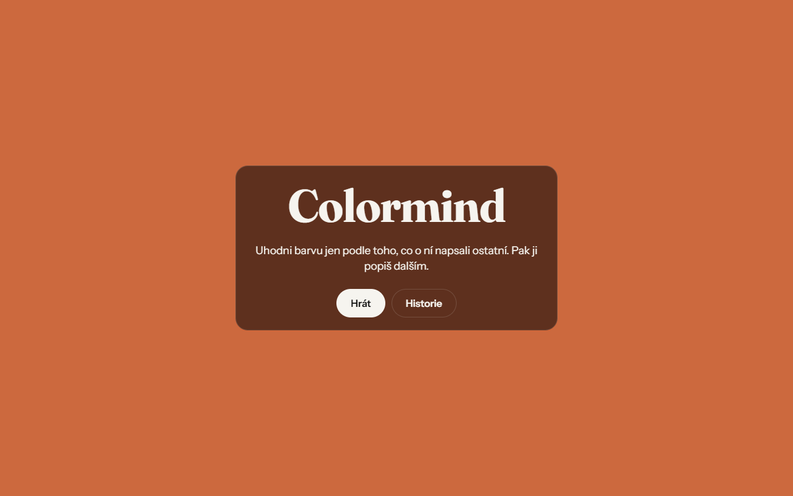

# Colormind



A multiplayer color-guessing game. Players describe colors with short hints; you read someone else's hints and try to hit the exact shade on a full-screen picker.

**Play:** <https://colormind.guth.workers.dev>

## How it works

- **Guess** — you get another player's hints for a hidden color and pick it on a smooth OKLCH picker. The picker only offers a 90° window of hues, so it is a matter of nuance, not luck.
- **Score** — 0–100 based on CIEDE2000 color difference, revealed with a diagonal split of your guess vs. the target. You can thumbs-up hints that helped.
- **Discover** — when the pool runs out, you choose one of three generated colors and write hints for others.
- **History** — played, discovered and pending colors are kept in `localStorage`, with a badge when your colors get new hints.
- **Admin** — dashboard with charts over games and hints.

## Stack

TypeScript, Vite, Cloudflare Workers + D1. No frontend framework, no runtime dependencies. Color math (OKLCH ↔ sRGB, CIEDE2000) is hand-written and unit-tested with Vitest.

## Running locally

```bash
npm install
npm run db:migrate   # apply migrations to the local D1
npm run dev
npm test
npm run typecheck
```

`npm run deploy` builds, applies remote migrations and deploys the Worker.

---

🇨🇿 **Česky:** Hra na hádání barev. Hráči popisují barvy krátkými nápovědami, ostatní podle nich hledají přesný odstín na OKLCH pickeru. Skóre podle CIEDE2000, po vyčerpání barev objevuješ nové a píšeš k nim nápovědy. TypeScript, Vite, Cloudflare Workers + D1.
